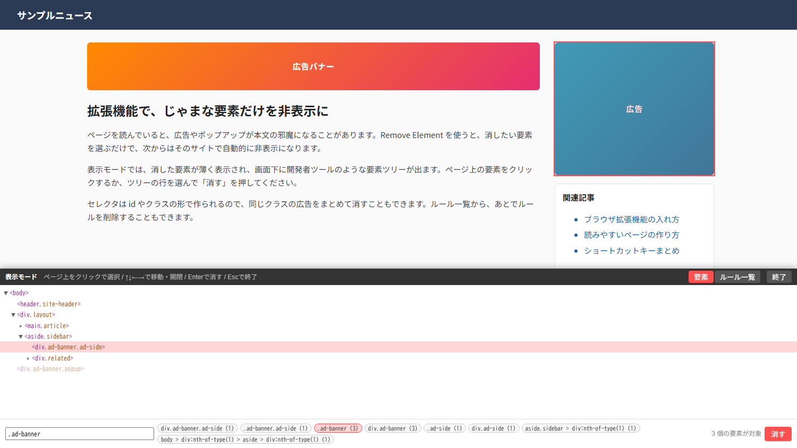

Remove Element：　[ダウンロードページ](https://okcysk.github.io/removeElementAddOn/)

広告などのじゃまな要素を選んで非表示にするブラウザ拡張機能です。

- 拡張機能のアイコンか、右クリックの「この要素を消す」で表示モードに入ります。
- ページ上か、画面下の要素ツリーで要素を選び、`#id`・`.class`・何番目かのセレクタで「消す」を押します。
- 消した要素は、次からそのサイトで自動的に非表示になります。ルール一覧からいつでも元に戻せます。

## Contact / 連絡先

- X: [@okcysk46770](https://x.com/okcysk46770)
- Email: [okcysk@gmail.com](mailto:okcysk@gmail.com)
